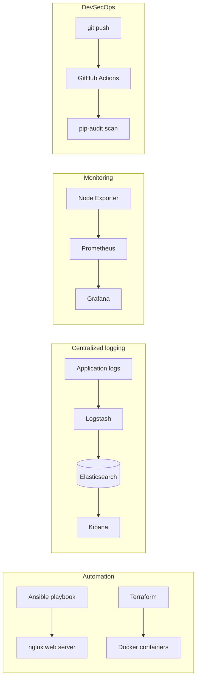

# DevOps Lab 3: Monitoring, Logging and DevSecOps

[](../../actions)


An end-to-end DevOps workflow: infrastructure provisioned and configured as code, logs and metrics collected and visualized, dependencies scanned for vulnerabilities in a CI pipeline, and the application verified with a feature flag, a load test and an automated browser test.

Built for the **DevOps and Automation Lab (ENSP461)**.

## Architecture



## Overview of the work

| Task | Folder | Focus | Stack |
|------|--------|-------|-------|
| 1 | `task1` | Configuration management | Ansible, nginx |
| 2 | `task2` | Scalable infrastructure as code | Terraform, Docker provider |
| 3 | `task3` | Centralized logging | Elasticsearch, Logstash, Kibana |
| 4 | `task4`, `.github/workflows` | Security in CI/CD | GitHub Actions, pip-audit |
| 5 | `task5` | Monitoring and dashboards | Prometheus, Node Exporter, Grafana |
| 6 | `task6` | Feature flags and testing | Flask, ApacheBench, Selenium |
| 7 | `task7` | Final report | Documentation |

## What each part does

### 1. Configuration management (Ansible)
An inventory targets the local machine and a playbook declares the desired state: install nginx, deploy a custom page and keep the service running. The playbook is idempotent, so running it again changes nothing. A run finished with `ok=4 changed=2 failed=0`.

### 2. Infrastructure as code (Terraform)
The Docker provider pulls the nginx image and creates web containers. The `count` argument sets how many exist, so scaling from 2 to 3 containers was a one-line change that Terraform applied by adding only the missing container. Workflow: `init`, `plan`, `apply`.

### 3. Centralized logging (ELK)
Logstash reads an application log, and a grok filter splits each line into `time`, `level` and `msg` fields. Elasticsearch stores the events in the `applogs` index and Kibana searches and charts them, including a breakdown of INFO, WARN and ERROR messages. Security is disabled for the lab; enable it for anything beyond local use.

### 4. Security in the pipeline (DevSecOps)
A GitHub Actions workflow runs on every push and scans `task4/requirements.txt` with pip-audit. The dependencies are intentionally outdated, and the scan reported **48 known vulnerabilities across 5 packages** (including transitive ones), each with a fixed version. The step reports without failing the build; to enforce a security gate, remove the `|| true` from the workflow.

### 5. Monitoring (Prometheus and Grafana)
Prometheus scrapes Node Exporter and itself every 5 seconds. Grafana uses Prometheus as its data source and shows the community **Node Exporter Full** dashboard (ID 1860) with live memory, network and uptime metrics. Inside Docker Desktop the exporter reports the virtual machine, so a few panels differ from a bare-metal host.

### 6. Feature flags and testing
- **Feature flag:** the `NEW_FEATURE` environment variable switches the page between the old and new version with no code change.
- **Load test:** ApacheBench sent 1000 requests at concurrency 50: **0 failures, about 343 requests per second**, mean 146 ms per request.
- **Browser test:** a headless Selenium test opens the page and asserts the new feature text.

## Repository layout

```text
.
├── .github/workflows/security.yml   # dependency scan on every push
├── task1/   # Ansible inventory and playbook
├── task2/   # Terraform configuration
├── task3/   # ELK docker-compose and Logstash pipeline
├── task4/   # sample app with intentionally old dependencies
├── task5/   # Prometheus config and docker-compose
├── task6/   # Flask app, Selenium test, recorded commands
└── task7/   # final report
```

## Getting started

**Requirements:** Docker with Compose, Ansible, Terraform and Python 3. Developed on WSL2 (Ubuntu 24.04) with Docker Desktop.

```bash
git clone <repository-url>
cd DevOps-Lab3
```

| Task | Run |
|------|-----|
| 1 | `cd task1 && ansible-playbook -i inventory.ini playbook.yml && curl localhost` |
| 2 | `cd task2 && terraform init && terraform apply -auto-approve` |
| 3 | `cd task3 && docker compose up -d` (Kibana on port 5601) |
| 5 | `cd task5 && docker compose up -d` (Prometheus 9090, Grafana 3000) |
| 6 | `cd task6 && NEW_FEATURE=on python3 app.py` |

Task 4 runs automatically on every push; results are in the repository's Actions tab.

**Clean up:** `docker compose down` in task3 and task5, and `terraform destroy -auto-approve` in task2.

## Notes and lessons learned

- Elasticsearch needs a higher `vm.max_map_count`. On Docker Desktop with WSL2, set it with `wsl -d docker-desktop sysctl -w vm.max_map_count=262144`.
- GitHub rejects files over 100 MB and requires a personal access token (with the `workflow` scope to push workflow files). Keep installers and Terraform state out of version control with `.gitignore`.
- Logs explain what happened, metrics show how the system is behaving, and automated scans catch problems before release. Together they shorten troubleshooting.

## License

MIT
